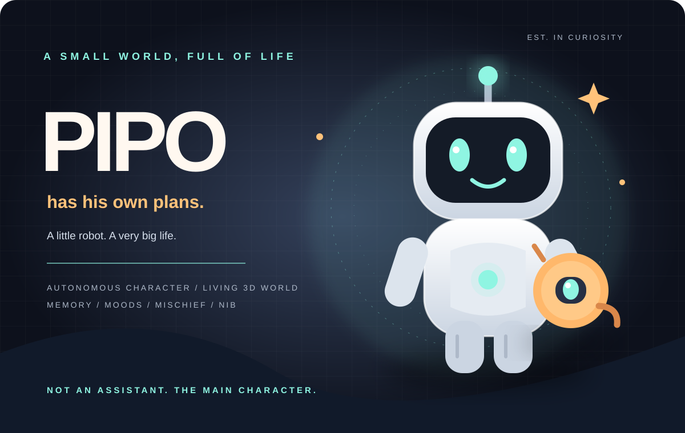
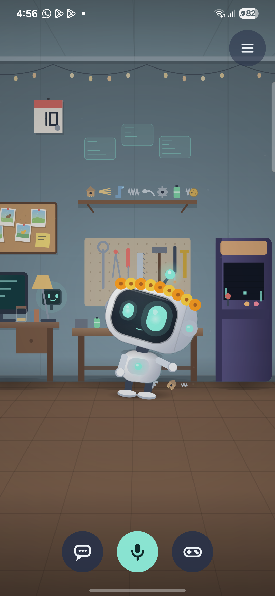
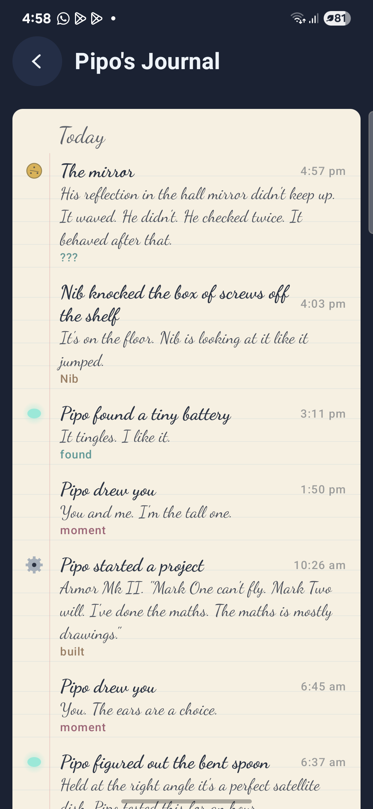
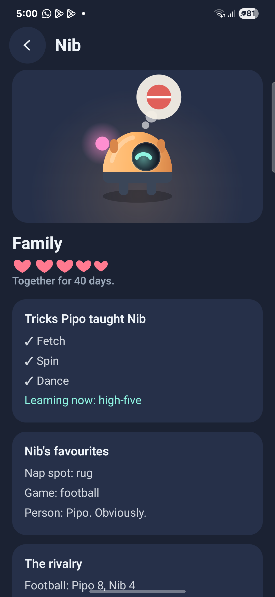
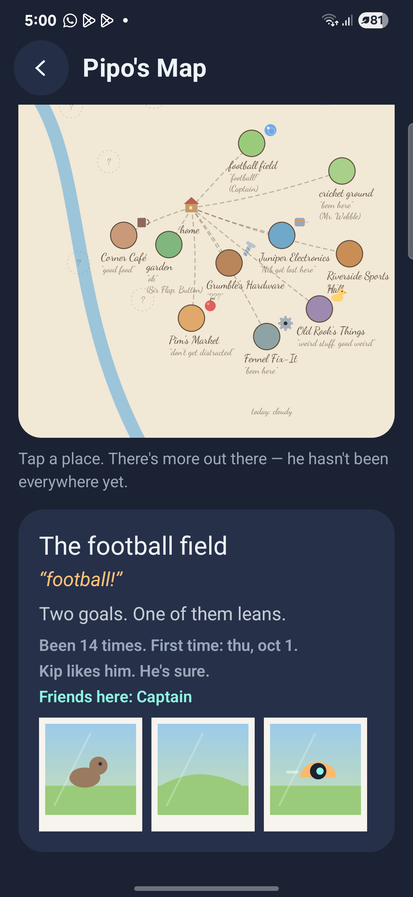
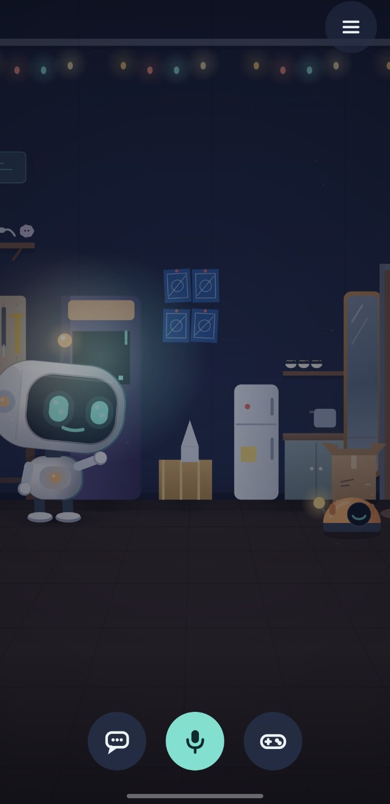

<div align="center">



</div>

<div align="center">

<a href="https://github.com/aspire488/Pipo/releases/download/v1.0/Pipo.apk"></a>

<br/>

<a href="https://github.com/aspire488/Pipo/releases/tag/v1.0"><strong>VIEW RELEASE NOTES ↗</strong></a>
&nbsp;&nbsp; · &nbsp;&nbsp;
<a href="https://www.producthunt.com/products/pipo-2?launch=pipo-3"><strong>FIND PIPO ON PRODUCT HUNT ↗</strong></a>
&nbsp;&nbsp; · &nbsp;&nbsp;
<a href="https://aspire488.github.io/Pipo/"><strong>ENTER THE LIVE 3D WORLD ↗</strong></a>
&nbsp;&nbsp; · &nbsp;&nbsp;
<a href="Pipo-Intro.mp4"><strong>WATCH THE INTRO ↗</strong></a>

<br/><br/>


</div>

<br/>

<div align="center">

# HE'S NOT WAITING FOR YOU.

### He's got places to be. Things to break. A tiny friend to blame.

</div>

**Pipo is an Android app.** A little robot lives in his own room on your phone and gets on with his day: his own traits, moods and memories, a pet called Nib, and a world that keeps moving while you are away. Free, offline-first, no ads, no analytics, MIT-licensed. **Install it in one tap: [download the APK](https://github.com/aspire488/Pipo/releases/download/v1.0/Pipo.apk).**

<div align="center">






<sub>Real screenshots from a Samsung Galaxy S23, taken during Diwali.</sub>

</div>

Pipo is an autonomous little robot with a persistent inner life. He makes plans, gets distracted, builds questionable inventions, goes exploring, remembers people, and occasionally just lies on the floor.

You don't manage him. You drop in and discover what happened.

---

<div align="center">

## A DAY IN THE LIFE

</div>

<table>
<tr>
<td width="50%" valign="top">

### ✳ A MIND OF HIS OWN

Curiosity becomes a project. A mood changes the plan. A failed experiment becomes a story. His traits, memories and needs shape what he chooses to do.

</td>
<td width="50%" valign="top">

### ☾ A WORLD THAT KEEPS MOVING

A room with its own rhythm. Weather at the window. Places to explore. Neighbours who remember him. Little traces of yesterday left lying around.

</td>
</tr>
<tr>
<td width="50%" valign="top">

### ◉ FEELINGS YOU CAN SEE

Sleepy slouch. Proud stance. Suspicious side-eye. Full-body excitement. His emotions show up in expression, movement, glow and voice.

</td>
<td width="50%" valign="top">

### ● NIB. THE TINY MENACE.

A round amber robot-pet with moods, habits and a talent for stealing shiny things. Pipo insists he's helpful. The evidence disagrees.

</td>
</tr>
</table>

<div align="center">

## THE WORLD IS OPEN

| <a href="https://aspire488.github.io/Pipo/"><strong>01 — WALK IN</strong></a> | <a href="https://aspire488.github.io/Pipo/classic/"><strong>02 — THE CLASSIC WORLD</strong></a> | <a href="https://github.com/aspire488/Pipo/releases/tag/v1.0"><strong>03 — TAKE HIM WITH YOU</strong></a> |
|:--:|:--:|:--:|
| <sub>Explore the living 3D room. Find Pipo. Follow his day.</sub> | <sub>The original 2D world, still alive.</sub> | <sub>Install the Android app and meet the deeper simulation.</sub> |

</div>

<div align="center">

## ONE REAL MOMENT FROM HIS WORLD



<sub>Actual Pipo app capture · Not a concept render</sub>

</div>

---

## GET PIPO ON ANDROID

<div align="center">

<a href="https://github.com/aspire488/Pipo/releases/download/v1.0/Pipo.apk"></a>

<br/>

<sub>Android 8.0+ · APK · 26.1 MB · SHA-256 verified release asset</sub>

</div>

1. Download **[Pipo.apk](https://github.com/aspire488/Pipo/releases/download/v1.0/Pipo.apk)**.
2. Open it on your Android device.
3. If prompted, allow your browser or file manager to install unknown apps.
4. Install Pipo and open him.

<details>
<summary><strong>VERIFY THE APK</strong></summary>

Release asset SHA-256:

```text
911b61a523da2b0c91c747fdf87fcbfcd318b6bde458385b3bd69c2c121e3526
```

[Release v1.0 and all release details](https://github.com/aspire488/Pipo/releases/tag/v1.0).

</details>

---

<details>
<summary><strong>TROUBLESHOOTING &amp; THE PLAY PROTECT PROMPT</strong></summary>

**"Play Protect says this app is unsafe / unverified."**
Expected. Pipo comes from GitHub, not the Play Store, so Google has no reputation for it. Play Protect
blocks or warns about *unverified* apps installed from a browser when they request sensitive
permissions — Pipo can ask for notification access (optional, off by default) for his "did you get a
message?" moments. It is a verification warning, not a malware detection. The full audit, with the APK
hash and signing certificate, is in
[`security/play-protect-investigation/`](security/play-protect-investigation/EXECUTIVE_SUMMARY.md).

If Android offers **"Install anyway"** (sometimes under *More details*), use that. **Do not turn Play
Protect off** — you do not need to, and it protects everything else on your phone.

**"App not installed" / "package appears to be invalid."**
Usually a truncated download. Check the SHA-256 above, re-download, try again.

**"Can't install over an existing Pipo."**
A copy signed with a different key must be uninstalled first. That **deletes his save** — the save
lives only on your phone.

**Nothing happens when I open the APK.**
Allow installs for the app you downloaded it with: Settings → Apps → *(your browser or Files)* →
Install unknown apps.

**He is silent.**
Pipo's voice uses your phone's text-to-speech engine. Check Settings → Accessibility → Text-to-speech
output, and update your TTS engine if it is disabled.

**No weather in the window.**
He needs a network connection once to estimate your city from your IP address. There is no account and
no location permission. You can turn it off in his Settings.

</details>

## OPEN SOURCE, BUILT TO BE IMPROVED

<table>
<tr>
<td width="50%" valign="top">

### CONTRIBUTIONS

Issues, focused pull requests, tests, documentation and visual improvements are welcome.

<a href="CONTRIBUTING.md"><strong>READ CONTRIBUTING GUIDELINES ↗</strong></a>

</td>
<td width="50%" valign="top">

### SECURITY

Found a vulnerability? Report it privately. Do not publish exploit details in a public issue.

<a href="SECURITY.md"><strong>READ SECURITY POLICY ↗</strong></a>

</td>
</tr>
</table>


Dependency updates are monitored through **Dependabot** for Gradle and GitHub Actions. Android builds run unit tests and upload the debug APK and test reports as workflow artifacts.

---

<details>
<summary><strong>THE ENGINE UNDER THE PERSONALITY</strong></summary>

Pipo's life is driven by a deterministic simulation, not a scripted sequence.

- **Personality:** ten traits evolve in bounded steps through experience.
- **Emotion:** continuous internal state drives twelve moods and transient reactions.
- **Autonomy:** activity selection weighs needs, interests, context and unfinished plans.
- **Memory:** persistent events and relationships influence future behaviour.
- **World:** trips, places, weather, neighbours, objects, projects and Nib connect into one simulation.
- **Offline continuity:** elapsed time is reconciled when Pipo returns; no always-running server is required.
- **Local-first:** the core experience persists on-device. Online AI, weather and voice are optional.

</details>

<details>
<summary><strong>RUN IT LOCALLY</strong></summary>

```bash
git clone https://github.com/aspire488/Pipo.git
cd Pipo
./gradlew testDebugUnitTest
./gradlew assembleDebug
```

Debug APK: `app/build/outputs/apk/debug/app-debug.apk`

</details>

<details>
<summary><strong>PROJECT NOTES & FEATURE HISTORY</strong></summary>

- [Feature history](docs/FEATURE_HISTORY.md)
- [Source code](https://github.com/aspire488/Pipo)
- [Releases](https://github.com/aspire488/Pipo/releases)
- [Contributing](CONTRIBUTING.md)
- [Security](SECURITY.md)
- [Discussions](https://github.com/aspire488/Pipo/discussions)
- [Privacy policy](https://aspire488.github.io/Pipo/privacy/)

</details>

<div align="center">

<br/>

### LET HIM GET ON WITH IT.

<sub>Made with curiosity, code, and a suspicious amount of personality.</sub>

<br/><br/>

<sub><a href="https://aspire488.github.io/Pipo/privacy/">Privacy policy</a> · no account, no analytics, no ads</sub>

</div>
